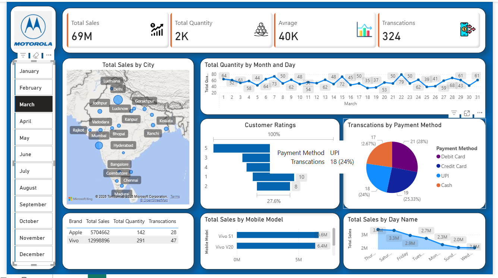

# Mobile-Sales-analytics-PowerrBI-Dashboard
Interactive Power BI dashboard analyzing mobile sales performance, regional distribution, customer ratings, and payment method trends.

# 📱 Mobile Sales Analytics Dashboard (Power BI)

An interactive Power BI dashboard designed to track and analyze mobile sales performance, customer preferences, regional revenue distribution, and payment trends.

## 📊 Key Performance Indicators (KPIs)
* **Total Sales:** 62M
* **Total Quantity Sold:** 2K
* **Average Price/Sales:** 39K
* **Total Transactions:** 321

## 🔍 Dashboard Highlights & Visuals
1. **Geographic Sales Analysis:** Interactive map displaying total sales across major cities (including Delhi, Mumbai, Bangalore, Hyderabad, Chennai, Kolkata, etc.).
2. **Time-Series & Day-Wise Trends:** 
   * Monthly slicer (January to December) for dynamic filtering.
   * Daily quantity trends by month and day.
   * Sales performance breakdown by day of the week.
3. **Product & Brand Insights:** Breakdown of total sales, quantity, and transactions by mobile model and brand.
4. **Customer Behavior:**
   * **Customer Ratings:** Distribution across 1 to 5-star ratings.
   * **Payment Methods:** Share of transactions via Credit Card, Debit Card, UPI, and Cash.

## 🛠️ Tools & Skills Used
* **Power BI Desktop:** Data modeling, DAX measures, and interactive data visualization.
* **Power Query:** Data cleaning, transformation, and formatting.
* **CSV Dataset:** Raw sales transaction records.

## 🚀 How to Use
1. Download the `.pbix` file and `.csv` dataset from this repository.
2. Open the `.pbix` file in **Power BI Desktop**.
3. If needed, update the data source path via `Transform data > Data source settings` to link the local CSV file.
